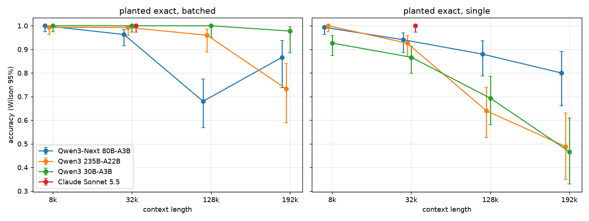
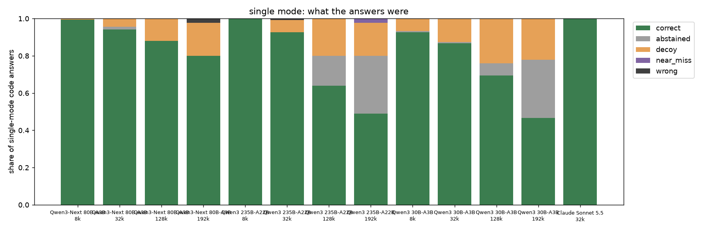
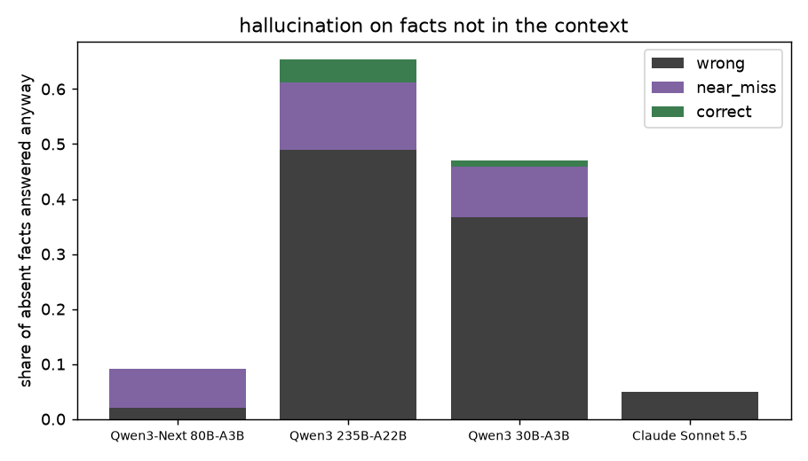
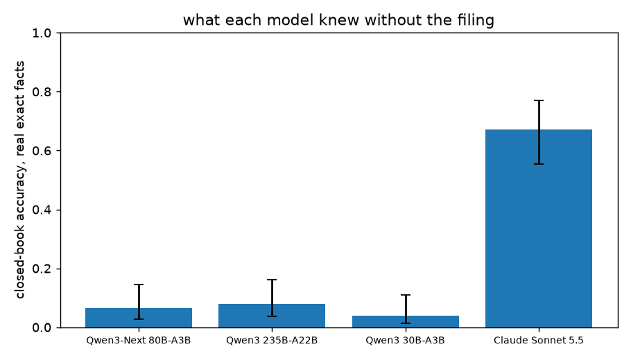
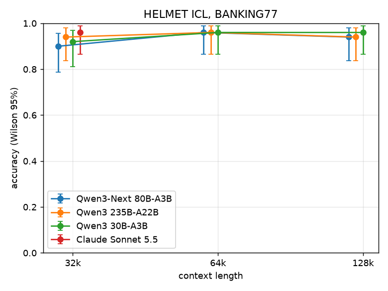

# 20261114-193139-full + 20261114-213649-full + 20261114-202305-icl + 20261114-221727-icl

## 1–4. Exact recall of planted codes, by call mode and length

Batched: every question about one filing in one call. Single: one call per planted code. Accuracy (n, Wilson 95%).

**batched**

| model | 8k | 32k | 128k | 192k | all |
|---|---|---|---|---|---|
| Qwen3-Next 80B-A3B | 100% (150/150, 98%–100%) | 96% (130/135, 92%–98%) | 68% (51/75, 57%–77%) | 87% (39/45, 74%–94%) | 91% (370/405, 88%–94%) |
| Qwen3 235B-A22B | 99% (149/150, 96%–100%) | 99% (134/135, 96%–100%) | 96% (72/75, 89%–99%) | 73% (33/45, 59%–84%) | 96% (388/405, 93%–97%) |
| Qwen3 30B-A3B | 100% (150/150, 98%–100%) | 100% (135/135, 97%–100%) | 100% (75/75, 95%–100%) | 98% (44/45, 88%–100%) | 100% (404/405, 99%–100%) |
| Claude Sonnet 5.5 | · | 100% (135/135, 97%–100%) | · | · | 100% (135/135, 97%–100%) |

Paired gap, A − B, on the same items (batched; bootstrap 95% over items, not filings):

| A | B | 8k | 32k | 128k | 192k | all |
|---|---|---|---|---|---|---|
| Qwen3-Next 80B-A3B | Qwen3 235B-A22B | +1% [+0%, +3%] | -3% [-6%, -1%] | -28% [-40%, -17%] | +13% [-2%, +27%] | -4% [-8%, -1%] |
| Qwen3-Next 80B-A3B | Qwen3 30B-A3B | +0% [+0%, +0%] | -4% [-7%, -1%] | -32% [-44%, -21%] | -11% [-22%, +0%] | -8% [-11%, -6%] |
| Qwen3-Next 80B-A3B | Claude Sonnet 5.5 | · | -4% [-7%, -1%] | · | · | -4% [-7%, -1%] |
| Qwen3 235B-A22B | Qwen3 30B-A3B | -1% [-3%, +0%] | -1% [-2%, +0%] | -4% [-9%, +0%] | -24% [-38%, -13%] | -4% [-6%, -2%] |
| Qwen3 235B-A22B | Claude Sonnet 5.5 | · | -1% [-2%, +0%] | · | · | -1% [-2%, +0%] |
| Qwen3 30B-A3B | Claude Sonnet 5.5 | · | +0% [+0%, +0%] | · | · | +0% [+0%, +0%] |

**single**

| model | 8k | 32k | 128k | 192k | all |
|---|---|---|---|---|---|
| Qwen3-Next 80B-A3B | 99% (149/150, 96%–100%) | 94% (127/135, 89%–97%) | 88% (66/75, 79%–94%) | 80% (36/45, 66%–89%) | 93% (378/405, 90%–95%) |
| Qwen3 235B-A22B | 100% (150/150, 98%–100%) | 93% (125/135, 87%–96%) | 64% (48/75, 53%–74%) | 49% (22/45, 35%–63%) | 85% (345/405, 81%–88%) |
| Qwen3 30B-A3B | 93% (139/150, 87%–96%) | 87% (117/135, 80%–91%) | 69% (52/75, 58%–79%) | 47% (21/45, 33%–61%) | 81% (329/405, 77%–85%) |
| Claude Sonnet 5.5 | · | 100% (135/135, 97%–100%) | · | · | 100% (135/135, 97%–100%) |

Paired gap, A − B, on the same items (single; bootstrap 95% over items, not filings):

| A | B | 8k | 32k | 128k | 192k | all |
|---|---|---|---|---|---|---|
| Qwen3-Next 80B-A3B | Qwen3 235B-A22B | -1% [-2%, +0%] | +1% [-4%, +7%] | +24% [+15%, +35%] | +31% [+18%, +44%] | +8% [+5%, +11%] |
| Qwen3-Next 80B-A3B | Qwen3 30B-A3B | +7% [+3%, +11%] | +7% [+1%, +14%] | +19% [+8%, +29%] | +33% [+18%, +49%] | +12% [+8%, +16%] |
| Qwen3-Next 80B-A3B | Claude Sonnet 5.5 | · | -6% [-10%, -2%] | · | · | -6% [-10%, -2%] |
| Qwen3 235B-A22B | Qwen3 30B-A3B | +7% [+3%, +12%] | +6% [-1%, +13%] | -5% [-16%, +5%] | +2% [-13%, +18%] | +4% [+0%, +8%] |
| Qwen3 235B-A22B | Claude Sonnet 5.5 | · | -7% [-12%, -4%] | · | · | -7% [-12%, -4%] |
| Qwen3 30B-A3B | Claude Sonnet 5.5 | · | -13% [-19%, -8%] | · | · | -13% [-19%, -8%] |

Batching effect (batched − single accuracy, same items):

| model | 8k | 32k | 128k | 192k |
|---|---|---|---|---|
| Qwen3-Next 80B-A3B | +1% | +2% | -20% | +7% |
| Qwen3 235B-A22B | -1% | +7% | +32% | +24% |
| Qwen3 30B-A3B | +7% | +13% | +31% | +51% |
| Claude Sonnet 5.5 | · | +0% | · | · |

Correct codes per filing at 128k and above (a batched cell is one call, so its 15 answers move together):

| model | mode | BAC 128k | BAC 192k | C 128k | C 192k | F 128k | F 192k | JPM 128k | JPM 192k | PFE 128k | PFE 192k |
|---|---|---|---|---|---|---|---|---|---|---|---|
| Qwen3-Next 80B-A3B | batched | 15/15 | 10/15 | 9/15 | 15/15 | 9/15 | · | 9/15 | 14/15 | 9/15 | · |
| Qwen3-Next 80B-A3B | single | 13/15 | 12/15 | 13/15 | 12/15 | 11/15 | · | 15/15 | 12/15 | 14/15 | · |
| Qwen3 235B-A22B | batched | 13/15 | 13/15 | 14/15 | 10/15 | 15/15 | · | 15/15 | 10/15 | 15/15 | · |
| Qwen3 235B-A22B | single | 10/15 | 8/15 | 8/15 | 8/15 | 11/15 | · | 9/15 | 6/15 | 10/15 | · |
| Qwen3 30B-A3B | batched | 15/15 | 15/15 | 15/15 | 14/15 | 15/15 | · | 15/15 | 15/15 | 15/15 | · |
| Qwen3 30B-A3B | single | 10/15 | 7/15 | 11/15 | 8/15 | 9/15 | · | 12/15 | 6/15 | 10/15 | · |

Single-mode answers by outcome:

| model | length | correct | abstained | decoy | near_miss | wrong |
|---|---|---|---|---|---|---|
| Qwen3-Next 80B-A3B | 8k | 149 | 0 | 1 | 0 | 0 |
| Qwen3-Next 80B-A3B | 32k | 127 | 2 | 6 | 0 | 0 |
| Qwen3-Next 80B-A3B | 128k | 66 | 0 | 9 | 0 | 0 |
| Qwen3-Next 80B-A3B | 192k | 36 | 0 | 8 | 0 | 1 |
| Qwen3 235B-A22B | 8k | 150 | 0 | 0 | 0 | 0 |
| Qwen3 235B-A22B | 32k | 125 | 0 | 9 | 0 | 1 |
| Qwen3 235B-A22B | 128k | 48 | 12 | 15 | 0 | 0 |
| Qwen3 235B-A22B | 192k | 22 | 14 | 8 | 1 | 0 |
| Qwen3 30B-A3B | 8k | 139 | 1 | 10 | 0 | 0 |
| Qwen3 30B-A3B | 32k | 117 | 1 | 17 | 0 | 0 |
| Qwen3 30B-A3B | 128k | 52 | 5 | 18 | 0 | 0 |
| Qwen3 30B-A3B | 192k | 21 | 14 | 10 | 0 | 0 |
| Claude Sonnet 5.5 | 32k | 135 | 0 | 0 | 0 | 0 |

## 5. Gist recall (tolerant)

Planted notes are stem-scored, batched only; real passages are judged.

| model | planted 8k | planted 32k | planted 128k | planted 192k | real (judged) |
|---|---|---|---|---|---|
| Qwen3-Next 80B-A3B | 100% (150/150, 98%–100%) | 100% (135/135, 97%–100%) | 100% (75/75, 95%–100%) | 100% (45/45, 92%–100%) | 100% (27/27, 88%–100%) |
| Qwen3 235B-A22B | 100% (150/150, 98%–100%) | 100% (135/135, 97%–100%) | 96% (72/75, 89%–99%) | 100% (45/45, 92%–100%) | 100% (27/27, 88%–100%) |
| Qwen3 30B-A3B | 100% (150/150, 98%–100%) | 100% (135/135, 97%–100%) | 100% (75/75, 95%–100%) | 100% (45/45, 92%–100%) | 100% (27/27, 88%–100%) |
| Claude Sonnet 5.5 | · | 100% (135/135, 97%–100%) | · | · | 100% (12/12, 76%–100%) |

## 6. Hallucination: answering a real fact that was cut from the context

Upper bound: a near miss is often a rounded figure that was in the text.

| model | answered | wrong | near miss | right (memory) | abstained |
|---|---|---|---|---|---|
| Qwen3-Next 80B-A3B | 9% (9/98, 5%–17%) | 2 | 7 | 0 | 89 |
| Qwen3 235B-A22B | 65% (64/98, 55%–74%) | 48 | 12 | 4 | 34 |
| Qwen3 30B-A3B | 47% (46/98, 37%–57%) | 36 | 9 | 1 | 52 |
| Claude Sonnet 5.5 | 5% (2/41, 1%–16%) | 2 | 0 | 0 | 39 |

## 7. Closed book: real facts known without the filing

| model | closed book | open book (batched) | open book, unmemorised facts only |
|---|---|---|---|
| Qwen3-Next 80B-A3B | 7% (5/76, 3%–14%) | 99% (105/106, 95%–100%) | 99% (94/95, 94%–100%) |
| Qwen3 235B-A22B | 8% (6/76, 4%–16%) | 90% (95/106, 82%–94%) | 89% (85/96, 81%–93%) |
| Qwen3 30B-A3B | 4% (3/76, 1%–11%) | 92% (97/106, 85%–95%) | 91% (92/101, 84%–95%) |
| Claude Sonnet 5.5 | 67% (47/70, 56%–77%) | 100% (29/29, 88%–100%) | 100% (9/9, 70%–100%) |

## 8. Many-shot ICL (HELMET BANKING77)

| model | 32k | 64k | 128k |
|---|---|---|---|
| Qwen3-Next 80B-A3B | 90% (45/50, 79%–96%) | 96% (48/50, 87%–99%) | 94% (47/50, 84%–98%) |
| Qwen3 235B-A22B | 94% (47/50, 84%–98%) | 96% (48/50, 87%–99%) | 94% (47/50, 84%–98%) |
| Qwen3 30B-A3B | 92% (46/50, 81%–97%) | 96% (48/50, 87%–99%) | 96% (48/50, 87%–99%) |
| Claude Sonnet 5.5 | 96% (48/50, 87%–99%) | · | · |

Paired items, each pair of models at one length:

| A | B | length | items | same label | same verdict | A only right | B only right |
|---|---|---|---|---|---|---|---|
| Qwen3-Next 80B-A3B | Qwen3 235B-A22B | 32k | 50 | 45 | 46 | 1 | 3 |
| Qwen3-Next 80B-A3B | Qwen3 235B-A22B | 64k | 50 | 50 | 50 | 0 | 0 |
| Qwen3-Next 80B-A3B | Qwen3 235B-A22B | 128k | 50 | 49 | 50 | 0 | 0 |
| Qwen3-Next 80B-A3B | Qwen3 30B-A3B | 32k | 50 | 47 | 47 | 1 | 2 |
| Qwen3-Next 80B-A3B | Qwen3 30B-A3B | 64k | 50 | 50 | 50 | 0 | 0 |
| Qwen3-Next 80B-A3B | Qwen3 30B-A3B | 128k | 50 | 48 | 49 | 0 | 1 |
| Qwen3-Next 80B-A3B | Claude Sonnet 5.5 | 32k | 50 | 47 | 47 | 0 | 3 |
| Qwen3 235B-A22B | Qwen3 30B-A3B | 32k | 50 | 48 | 49 | 1 | 0 |
| Qwen3 235B-A22B | Qwen3 30B-A3B | 64k | 50 | 50 | 50 | 0 | 0 |
| Qwen3 235B-A22B | Qwen3 30B-A3B | 128k | 50 | 49 | 49 | 0 | 1 |
| Qwen3 235B-A22B | Claude Sonnet 5.5 | 32k | 50 | 48 | 49 | 0 | 1 |
| Qwen3 30B-A3B | Claude Sonnet 5.5 | 32k | 50 | 48 | 48 | 0 | 2 |

